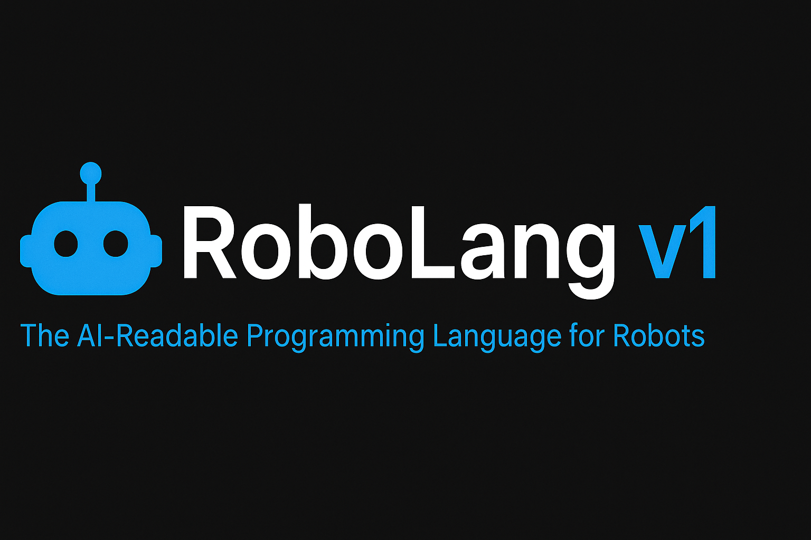

<p align="center">
  
  
  
  
  
</p>

<p align="center">
  <b>RoboLang</b> — An AI-native language and interoperability foundation for robots.<br/>
  Built by <a href="https://github.com/rokorobot">@rokorobot</a>
</p>
<p align="center">
  
</p>

---

# RoboLang

RoboLang is a task language for robots, written mainly by AI systems and reviewed by people.
A task declares what must be true before it starts, the **goal** it must achieve, the steps to
take, and safety limits. RoboLang checks the task statically and runs it in a deterministic,
symbolic simulation. A run **succeeds only when the goal is verified** in the final world, not
merely because the steps ran.

> ⚠️ **Simulation only.** Physical robot execution is not implemented or authorized. RoboLang
> does not replace ROS 2, MoveIt 2, Nav2 or hardware safety controllers. Do not run it against
> real hardware.

Created and maintained by **Robert Konecny (@rokorobot)**. Licensed under Apache 2.0.

## Quickstart

You need Python 3.11 or newer. No ROS 2, no robot, no other packages.

```bash
git clone https://github.com/rokorobot/RoboLang.git
cd RoboLang
python -m pip install .

robolang reference
robolang validate examples/handover.rob
robolang inspect  examples/handover.rob --json
robolang simulate examples/handover.rob --world examples/world.json
```

`simulate` prints `simulation only: run sim-…: SUCCEEDED`, then the run record as JSON. The
same commands work from a clone without installing: `python src/robolang validate FILE.rob`.
Add `--world WORLD` to `validate` to also catch, before any simulation, failures a run would certainly hit
in that world: a speed limit above the robot's profile, a grasp without a gripper, a sensor on another robot.

Bind task parameters on the command line instead of in the world file (`FILE` comes first):

```bash
robolang simulate examples/handover.rob --world examples/world.json \
    --bind arm=arm1 mobile=amr1 box=box1 src=shelf handoff=handoff dst=table zone=handoff_zone
```

| Command | What it does | Exit status |
|---|---|---|
| `reference` | Prints the tested RoboLang 1.3 language reference shipped in the package | 0 |
| `validate FILE` | Checks the file and prints **every** diagnostic (up to 50) as `file:line:column: error[CODE]: …` | 0 valid, 1 invalid, 2 usage error |
| `inspect FILE [--json] [--task NAME]` | Validates, then shows the tasks as text or as Task IR JSON | as `validate` |
| `simulate FILE --world W [--task NAME] [--bind P=ID …]` | Runs one task against a world file in a symbolic simulation; the same inputs give a byte-identical run record | 0 succeeded, 1 invalid source, 2 usage, 3 invalid world, 4 failed, 5 cancelled |
| `export-goal FILE --world W --from AGENT [--to ROBOT] [--bind P=ID …]` | Turns a 1.3 task's goal into a signed Core 0.1 `propose_goal` message (simulation-only signature) | 0 printed, 1 invalid source, 2 usage, 3 invalid world, 6 goal has no Core form |
| `delegate FILE --world W --from AGENT --to ROBOT [--plans PATH …] [--lease D]` | End to end: the planner sends the task's goal; the robot matches it (in any order) to a plan in its own `.rob` library, runs it, and returns a Core outcome; the planner checks the evidence itself. A plan with a second robot brings it in as a peer: commitment with a lease, then custody transfer before the peer's steps ([spec](spec/delegate-v0.2.md)) | 0 verified success, 4 failed or unknown, 7 rejected; others as `export-goal` |
| `arch02 --scenario S --cases C --case NAME` | Runs one case of the Core 0.1 reference scenario (AI planner, arm and mobile robot exchanging signed messages) | 0 ran, 2 usage, 3 invalid input |

Every command that reads a `.rob` file also reads Task IR JSON instead: `--ir FILE.json`. The IR is
re-validated from scratch; its version claims are never trusted ([spec](spec/ir-reader-v0.1.md)).

Validation and simulation say nothing about whether a task is safe on a real robot.

## The language

```rob
robolang 1.3;

task handover(robot arm, robot mobile, object box, location src, location handoff, location dst, region zone) {
    @safety max_speed 0.5 m/s;

    pre {
        robot_ready arm;
        robot_ready mobile;
        object_exists box;
    }

    goal {
        object_at box dst;
    }

    plan {
        move arm to src;
        grasp arm box;
        move arm to handoff;
        place arm box at handoff;
        communicate arm to "fleet" with "BOX_AT_HANDOFF";
        wait until region_clear zone timeout 30s;
        move mobile to handoff;
        grasp mobile box;
        move mobile to dst;
        place mobile box at dst;
    }
}
```

- **Parameters are typed** (`robot`, `object`, `location`, `region`, `sensor`) and bound to
  world IDs at run time, so one task runs in many worlds.
- **Goals decide success.** After the plan, every `goal` condition is checked against the final
  world: all true → `SUCCEEDED`; any false → `FAILED` (`S301`); otherwise unknown → `FAILED`
  (`S302`). Goal conditions: `object_at`, `robot_at`, `holding`, plus every precondition form.
- **Preconditions fail closed.** Logic is three-valued: a `false` or `unknown` condition stops
  the run.
- **Steps:** `move`, `grasp`, `place`, `inspect … using`, `wait for`, `wait until … timeout`,
  `communicate`. Plans are sequential.
- **Versions:** unmarked files are 1.1. `robolang 1.2;` adds `and`, `or`, `not`.
  `robolang 1.3;` adds the required `goal` block, the outcome conditions and `sensor`
  parameters.
- **`@safety max_speed`** is checked against the robot's profile and recorded, never enforced.

Specifications: [1.1](spec/robolang-v1.1.md) ([grammar](spec/grammar.ebnf)),
[1.2](spec/robolang-v1.2.md) ([grammar](spec/grammar-v1.2.ebnf)),
[1.3](spec/robolang-v1.3.md) ([grammar](spec/grammar-v1.3.ebnf)),
[Task IR](spec/ir-schema-v1.2.md), [simulation, world file and run record](spec/simulation-v1.0.md).

## How it fits together

```text
.rob source ─ lexer + parser ─ validator ─ Task IR (JSON) ─┬─ symbolic executor ─ run record (JSON)
                                                          world file
```

| Component | Where |
|---|---|
| Lexer, parser, validator | `src/robolang/lexer.py`, `parser.py`, `validator.py` |
| Task IR | `src/robolang/ir.py` |
| Symbolic executor and run records | `src/robolang/sim/` |
| Core 0.1 message checks (schemas, canonical JSON, simulation-only signatures) | `src/robolang/core/` |
| Core 0.1 reference simulation | `src/robolang/arch02/` |
| Task IR reader and re-validator (CORE-1) | `src/robolang/ir_reader.py` |
| `.rob` → Core bridge, `export-goal`, `delegate` | `src/robolang/bridge.py`, `export_goal.py`, `delegate.py`, `delegate_peer.py` |
| Interoperability test harness (gate 2) | `src/robolang/interop/` |
| CLI | `src/robolang/cli.py` |

**RoboLang Core 0.1** is a separate, draft layer: a JSON message envelope and capability
descriptor for AI-to-robot and robot-to-robot exchanges, with authority, custody and
evidence-backed outcomes. It runs only inside the `arch02` reference simulation.

The bridge from `.rob` to Core ([plan](docs/plans/goals-and-core-bridge.md)) is built, in simulation.
Goal conditions `object_at`, `robot_at` and `holding` map to Core `located_in` and `carried_by`
facts (`src/robolang/bridge.py`). `export-goal` sends a task's goal as a Core `propose_goal`,
and every 1.3 run record ends with `core_outcome`: a Core outcome with signed observations as
evidence. `delegate` closes the loop: the goal crosses as a Core message, the robot runs its
own `.rob` plan (plans never travel, Core decision R3), and the planner accepts `succeeded`
only after re-checking the signed evidence ([spec](spec/delegate-v0.1.md)):

```bash
robolang delegate examples/handover.rob --world examples/world.json \
    --from rl:agent:planner-1 --to rl:robot:arm1 --plans examples/plans
# simulation only: delegate rl:goal:handover → rl:robot:arm1: succeeded (verified)
```

See
[Core 0.1](spec/core-v0.1.md), the
[reference simulation](spec/reference-simulation-v0.1.md) and
[RFC-001](spec/architecture/rfc-001-ai-native-architecture.md).

## Limitations

- **Symbolic world only:** facts such as location, holding, readiness and region status. No
  motion planning, kinematics, collisions or physics. Only `wait` steps advance time.
- **Speed limits are recorded, not enforced.**
- **No hardware, no ROS 2 runtime, no network transport.** Core signatures are
  simulation-only.
- **No branching, loops or local bindings yet** (planned language extensions).
- The original v1 interpreter and ROS 2 adapter live in [`legacy/`](legacy/). They bypass the
  validator, are never installed and were never validated against ROS 2
  ([details](docs/legacy-v1.md)).

## Status and roadmap

| Area | State |
|---|---|
| Language 1.1, 1.2 and 1.3 (goals, typed sensors), validator, Task IR | Delivered |
| Language 1.4 (bounded `if`/`else`, `fail`; [0027](spec/decisions/0027-bounded-branching.md)): `validate`, `inspect`, Task IR 1.3 | Complete in code: front end, `simulate`, `export-goal` and `delegate` run branching tasks (record 1.3, [simulation 12](spec/simulation-v1.0.md)), `validate --world` checks every path, language reference and benchmark scoring per path. Acceptance run (set 3 under 1.4) pending |
| Simulation-only execution (`simulate`) | Delivered, signed off 2026-10-27 ([evidence](docs/evidence/rl-basic-01-exit-gate.md)) |
| Core 0.1 reference simulation (`arch02`) | Implemented, gate 1 signed off 2026-10-27 ([evidence](docs/evidence/rl-arch-02-exit-gate.md)) |
| Gate 2 independent interoperability | Bundle frozen 2026-10-28. INTEROP-3 deferred until Core 0.2 or a real second implementer ([0023](spec/decisions/0023-keep-interop-3-deferred.md)) |
| `.rob` → Core bridge | Delivered in simulation: Core-shaped outcomes, `export-goal`, `delegate` with a peer robot, commitment, lease and custody ([plan](docs/plans/goals-and-core-bridge.md)) |
| CORE-1, Task IR reader | Delivered: `--ir` on every command ([0021](spec/decisions/0021-core-1-ir-reader.md)) |

Every implementation item needs owner approval. The full plan and history are in the
[development plan](docs/DEVELOPMENT_PLAN.md); decisions are in [`spec/decisions/`](spec/decisions/).

`robolang --version` prints three independent versions: the Python package (`0.1.0a1`, alpha),
the language (`1.1`, `1.2`, `1.3`) and the Task IR schema (`1.0`, `1.1`, `1.2` for 1.1, 1.2
and 1.3 sources).

## Contributing

Pull requests are welcome. Keep each change small, with CI passing. New syntax, IR kinds and
Core schemas need a versioned specification and an owner decision first.

```bash
python -m pip install -r requirements-dev.txt
python -m pytest -q
python -m ruff check .
python tools/smoke_install.py   # builds and installs the wheel and sdist into fresh venvs; needs network
```

Tests marked `xfail` describe planned behaviour. Report problems in
[Issues](https://github.com/rokorobot/RoboLang/issues). Documentation site:
[rokorobot.github.io/RoboLang](https://rokorobot.github.io/RoboLang/).

## License

Licensed under the **Apache License 2.0**: free to use, modify and distribute in open or
commercial robotics projects.
