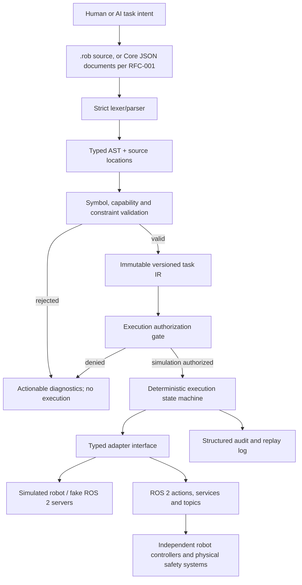

# RoboLang Development Plan — v1.1 to v2.0

**Project:** [rokorobot/RoboLang](https://github.com/rokorobot/RoboLang)  
**Plan date:** 2026-10-11  
**Revised:** 2026-10-19, aligned with the approved [RFC-001](../spec/architecture/rfc-001-ai-native-architecture.md) ([decision record 0002](../spec/decisions/0002-ai-native-architecture.md)); 2026-10-27, milestone order amended by decision F5 and development tracks added ([decision records 0003](../spec/decisions/0003-language-foundation.md), [0004](../spec/decisions/0004-rl-basic-01a-simulation-semantics.md), [0005](../spec/decisions/0005-ai-first-charter-and-domain-contracts.md))  
**Status:** Active development roadmap; RoboLang 1.1 and simulation-only Foundation 1 delivered. **Physical execution remains unauthorized.**  
**Maintainer/Product owner:** Repository owner  
**Scope:** Formal language → simulated execution of the language (RL-BASIC-01) → Core and A2R/R2R proof → safe task execution → robot interoperability → AI-native generation  
**Reference baseline:** `main` at `efd5a73` (2026-10-27), the Foundation 1 integration. The original plan inspected `9e9f92f` (2025-11-08); section 2 records that historical baseline.

> **Mission (approved 2026-10-19, decision D1):** RoboLang is an open, AI-native interoperability platform for embodied intelligence. It defines shared semantic contracts, A2R and R2R communication profiles, portable robotic capabilities, and verifiable cooperation across heterogeneous robots, AI systems and execution technologies. RoboLang is designed to support a vendor-neutral ecosystem of interoperable implementations, reference runtimes, developer tools and reusable skills, without requiring one operating system, middleware, controller, AI model or cloud provider.
>
> RoboLang is **not** intended to replace C++, Python, ROS 2, MoveIt 2, Nav2, or hardware safety controllers. Execution goes through interchangeable backends, ROS 2 among them. The architecture is defined in [RFC-001](../spec/architecture/rfc-001-ai-native-architecture.md).

> **Previous mission (2026-10-11, superseded):** Make RoboLang a trustworthy, robot-independent *task specification and coordination language* that can express what a robot should do, validate constraints, and delegate execution to established ROS 2 controllers.

---

## 1. Executive decision and release strategy

Build four **sequential, evidence-gated milestones**. Do not begin the next milestone until its exit criteria pass and the product owner approves it. Keep the currently working console demonstration usable throughout migration. Every change goes through a small PR with CI, review evidence, and explicit approval to merge. Never automatically connect generated tasks to physical hardware.

| Milestone | Outcome | Gate / demonstration | Release class |
|---|---|---|---|
| **v1.1 — Language correctness** | Deterministic grammar, AST, symbol binding, type checking and clear errors | All valid samples compile to a typed task model; invalid inputs reject with useful diagnostics | Parser/validator, simulation only |
| **v1.2 — Execution correctness** | Preconditions, limits, capabilities, failure handling and safe ROS 2 action semantics | Violations block commands; failed, rejected or timed-out actions fail explicitly | Simulation/fake ROS 2 servers; no automatic hardware enablement |
| **v1.3 — Interoperability** | Same task on two different simulated robot profiles; typed messages with acknowledgement | Portable task and robot-to-robot handoff pass the integration suite | Multi-robot simulation |
| **v2.0 — AI-native language** | Provider-agnostic language generation, deterministic validation and measured effectiveness | Held-out LLM task benchmark; unsafe proposals reliably rejected before execution | Controlled AI-generated task planning |

**Non-goals for this roadmap:** writing new motor controllers, replacing ROS 2, open-ended autonomous operation in public spaces, safety certification, new robot hardware purchases, distributed consensus (RFC-001 version 0 uses bilateral, leased commitments only; decision D5), inventing an emergent robot language (meaning a language robots develop among themselves; the A2R and R2R profiles are designed and specified, not emergent; decision D7), or incorporating Bend proofs into production before a separate feasibility study.

**Milestone order (decision D8, approved 2026-10-19; amended by decision F5, approved 2026-10-26):**

| # | Milestone | State |
|---|---|---|
| 1 | v1.1 — language correctness (RL-11A to RL-11E) | Delivered |
| 2 | **RL-BASIC-01** — simulation-only execution of RoboLang 1.1 tasks: specification RL-BASIC-01a ([`simulation-v1.0.md`](../spec/simulation-v1.0.md)), implementation BASIC-1 to BASIC-3 (`robolang simulate`) | **Delivered.** RL-BASIC-01 and Foundation 1 exit gates signed off by the owner on 2026-10-27 ([evidence](evidence/rl-basic-01-exit-gate.md)); merged into `main` |
| 3 | **RL-ARCH-02** — an in-process simulation of the RFC-001 reference scenario (one AI agent stub and two robot stubs) with its failure variants | **Implemented** (simulation only): specification RL-ARCH-02a approved 2026-10-27 ([`core-v0.1.md`](../spec/core-v0.1.md), [`reference-simulation-v0.1.md`](../spec/reference-simulation-v0.1.md), decision records [0007](../spec/decisions/0007-rl-arch-02-core-and-reference-simulation.md) and [0008](../spec/decisions/0008-core-sequencing-per-recipient.md)); ARCH-1, ARCH-2, ARCH-SEQ and ARCH-3 delivered. Gate 1 (A-T1 to A-T20) PASS, signed off by the owner on 2026-10-27 ([evidence](evidence/rl-arch-02-exit-gate.md)) |

D8 as first approved named RL-ARCH-02 as the next milestone; F5 placed RL-BASIC-01 before it, and language extensions beyond RoboLang 1.1 do not delay it. The v1.2 and v1.3 work packages below remain, re-framed: v1.2 execution work becomes the execution side of A2R, and the v1.3 communication work is superseded by the RFC-001 Core envelope and R2R profile (see the notes in sections 5 and 6). The developer-preview pilot of v1.1 is independent of this order.

**Language Foundation and development tracks (decisions F1–F5, G1–G7):** RoboLang is developed as one AI-first language covering thirteen domains ([RL-FOUNDATION-01](../spec/architecture/rl-foundation-01-language-foundation.md), [AI-First Language Design Charter](../spec/architecture/ai-first-language-charter.md)), in three stages: Foundation 1 (essential language), Foundation 2 (intelligent behavior) and Foundation 3 (advanced robotics). The work is broken down into five tracks ([RL-FOUNDATION-02 section 5](../spec/architecture/rl-foundation-02-domain-contracts.md#5-work-breakdown)):

| Track | Content | State |
|---|---|---|
| A — Foundation 1 | BASIC-1, BASIC-2, BASIC-3 (RL-BASIC-01b) | Delivered; Foundation 1 exit gate signed off 2026-10-27 |
| B — Part B language extensions | LANG-1 to LANG-6: combined conditions, branching, bounded repetition, typed values and comparisons, local bindings, structured data | LANG-1 (combined conditions, RoboLang 1.2) specification approved 2026-10-27, implemented by LANG-1b ([`robolang-v1.2.md`](../spec/robolang-v1.2.md), [decision record 0006](../spec/decisions/0006-lang-1-combined-conditions.md)). LANG-2 to LANG-6 not started. Scheduled independently by the owner; each needs a versioned specification and owner decision; none delays RL-ARCH-02 |
| C — Core | CORE-1 (IR reader and re-validator) and RL-ARCH-02 | RL-ARCH-02a specification (Core 0.1 and the reference simulation) approved 2026-10-27 ([`core-v0.1.md`](../spec/core-v0.1.md), [`reference-simulation-v0.1.md`](../spec/reference-simulation-v0.1.md), [decision record 0007](../spec/decisions/0007-rl-arch-02-core-and-reference-simulation.md)). ARCH-1 (Core 0.1 checks, `robolang.core`) and ARCH-2 (reference simulation, `robolang.arch02`) implemented; sequencing per recipient approved 2026-10-27 in [decision record 0008](../spec/decisions/0008-core-sequencing-per-recipient.md) and implemented by ARCH-SEQ; ARCH-3 (run record, run ID, `robolang arch02`) implemented. RL-ARCH-02 gate 1 PASS, signed off 2026-10-27. Gate 2 (RL-INTEROP-01, independent interoperability) specification approved 2026-10-27 in [`interop-gate-2-v0.1.md`](../spec/interop-gate-2-v0.1.md) and [decision record 0009](../spec/decisions/0009-gate-2-independent-interoperability.md); binding erratum approved 2026-10-27 in [decision record 0010](../spec/decisions/0010-binding-errata-lease-expired-commitment-state.md); INTEROP-1 (binding self-test, `robolang.interop`) implemented, in review; INTEROP-2 to INTEROP-4 not authorized. CORE-1 not started; RL-ARCH-02 does not depend on it (R3). Each needs separate implementation authorization |
| D — Foundation 2 | F2-1 to F2-6: goal execution, Core-shaped observations, knowledge store, reasoner proposals, bounded recovery, world-model depth | Not started. Its gate (Foundation 1) is met. Each item needs owner authorization before implementation, and its own versioned specification where it adds `.rob` syntax, an IR kind or a Core schema (G5, G6) |
| E — Foundation 3 | F3-1 to F3-6: concurrency, resources, portable skills, ROS 2 backend, two-profile portability, A2A binding | Later, once the basic semantics are proven |

Listing a track or item here authorizes nothing: every implementation item needs owner authorization before it starts.

**Release numbering:** Versions above are *targets*, not existing releases. Breaking syntax changes require migration notes and a declared compatibility policy. Avoid new versions solely for publicity.

---

## 2. Verified repository baseline and critical gaps

Inspected files: [`README.md`](https://github.com/rokorobot/RoboLang/blob/main/README.md), [`src/robolang_runtime.py`](https://github.com/rokorobot/RoboLang/blob/main/src/robolang_runtime.py), [`src/robolang_adapter.py`](https://github.com/rokorobot/RoboLang/blob/main/src/robolang_adapter.py), [`src/robolang_adapter_ros2.py`](https://github.com/rokorobot/RoboLang/blob/main/src/robolang_adapter_ros2.py), [`src/robolang_ros2_main.py`](https://github.com/rokorobot/RoboLang/blob/main/src/robolang_ros2_main.py), [`setup.py`](https://github.com/rokorobot/RoboLang/blob/main/setup.py), and example `.rob` files. These findings are **source-review observations**, not results of executing a test suite.

1. The current runtime is explicitly a **line-based prototype**. It scans `plan { ... }` and dispatches by `startswith(...)`; it lacks a formal grammar, AST, name resolution, and type checking. Unknown lines may be printed as ignored instead of failing.
2. `@safety` and `pre { ... }` are shown in examples but are **not enforced** by the current interpreter.
3. `move` currently ignores the requested destination and sends a **fixed joint vector**; simulated movement prints commands rather than simulating physics.
4. The simulated adapter reports `region_clear` and `sensor_ok` as true by default. The ROS 2 adapter also assumes success when optional status services are absent. These behaviors are unacceptable for safety-sensitive gating.
5. The ROS 2 adapter can return success for an accepted action without validating the final **action-specific error code/result**. Timeout/cancellation/exception paths need explicit semantics.
6. Robot communication currently uses a plain string on a ROS 2 topic, without a structured schema, acknowledgement, correlation ID, retries, or deduplication.
7. No automated tests or GitHub CI were visible in the reviewed tree. `requirements.txt`, both Docker files, and some example files are empty. The ROS 2 packaging/install path needs a reproducible test before claiming installability.
8. The repository is documented as **v1.0.0**; the most recent public commit inspected dates to **2025-11-08**. No verified physical-hardware execution or cross-robot demonstration was found.

**Immediate risk classification:** The current prototype must be treated as a **non-safety-certified demonstration**. Do not allow its current interpreter or defaults to move physical hardware without an independent safety review, robot-specific safeguards, and the relevant later gates.

---

## 3. Target architecture and key contracts



### Architectural decisions proposed for approval

- **A1 — One authoritative front end:** Use a proper parser and a typed intermediate representation (IR) shared by validation, dry-run, simulation and ROS 2 execution. No separate interpretation of arbitrary text in the ROS adapter.
- **A2 — Fail closed:** Unknown syntax, missing symbols, unsupported robot capabilities, unavailable safety status, stale status, rejected action results or unspecified safety-relevant behavior must **block the affected operation** with a nonzero error; do not silently skip or assume safe.
- **A3 — Separate policy from hardware:** The grammar and IR describe the task; robot-specific adapters resolve coordinates, kinematics and controller semantics. Never encode hard-coded joint values as the meaning of `move r to dst`.
- **A4 — Deterministic core:** The compiler/validator/executor should not invoke an LLM at runtime. AI proposes `.rob` source or, per RFC-001 (decision D2), Core JSON documents directly; deterministic software checks it before use. A robot may run a model for its own decisions, but RoboLang components stay deterministic and model output is untrusted input (RFC-001 section 13.4).
- **A5 — Simulation-first:** Physical robot execution is *disabled by default* and needs separate explicit enablement, robot risk assessment, independent emergency-stop/protective controls, and owner approval. A `@safety` DSL annotation is not a hardware safety system. Restated in RFC-001 section 13.3: standing authorizations carry an explicit `simulation` or `physical` mode.
- **A6 — Technology:** Python 3.11+ for language tooling and the reference implementation. Under principle P10 (RFC-001, decision D9) the Core must remain implementable from the specification alone, without the Python package; `pytest` for tests; a mature parser generator such as **Lark** may be adopted after a small spike. ROS 2 integration is isolated and tested separately; prefer ROS 2 Jazzy on the existing Ubuntu 24.04 environment, subject to compatibility verification.
- **A7 — Compatibility:** Keep and test original `examples/pick_and_place.rob` as a v1 compatibility fixture, or document an explicit intentional migration. No silent semantic drift.
- **A8 — Provider independence:** AI clients for OpenAI and Anthropic must produce the same `.rob`/IR contract. No provider-specific logic in the language compiler or executor.

### Suggested future package shape (proposal, not an existing directory tree)

```text
src/robolang/
  grammar/             # .lark or equivalent formal grammar
  ast.py               # typed AST nodes and source spans
  parser.py            # parsing + diagnostics
  symbols.py           # identifiers and binding
  types.py             # types and capability checks
  compiler.py          # validated AST -> versioned task IR
  ir.py
  policy.py            # declarative constraints
  executor.py          # state machine / cancellation / results
  adapters/
    base.py            # typed adapter Protocol/ABC
    simulated.py       # deterministic, injectable fake state
    ros2.py            # ROS 2-specific integration
  comms/               # message contracts and handoff protocol
  ai/                  # provider-neutral generation only (v2.0)
  cli.py
spec/
  robolang-v1.1.md     # syntax, semantics, errors, examples
  grammar.ebnf
examples/
tests/
  grammar/ semantic/ executor/ ros2/ interoperability/ ai/
.github/workflows/ci.yml
pyproject.toml
```

This proposed restructuring must be performed incrementally without breaking existing demo commands until replacements are proven.

---

## 4. v1.1 — Language correctness

**Objective:** Replace loosely scanned text with a strict, testable language contract. Validation is not execution. **No new physical execution capability** ships in this stage.

### Scope and implementation work

| Work package / suggested PR | Implementation | Evidence and acceptance |
|---|---|---|
| **RL-11A — Specification and grammar** | Define formal grammar for `task`, typed parameters, `@safety`, `pre`, `plan`, statements, identifiers, literals, delimiters, comments and whitespace. Specify syntax version, precedence and unsupported features. | Grammar published; every bundled non-empty example classified valid or migration-required; invalid syntax has documented behavior. |
| **RL-11B — Parser and AST** | Build deterministic parser; preserve line/column/span for every node; add structured syntax exceptions; reject extra trailing tokens and nested malformed blocks. | Golden AST fixtures, line/column tests, whitespace/comment tests, fuzz-style malformed-input tests; no action dispatch on parse errors. |
| **RL-11C — Binding, types, capability declarations** | Resolve task parameters (`robot`, `object`, `location`, `region`), detect duplicates/unbound names, distinguish known actions and check argument kinds; define a minimal robot capability model. | Negative tests for undeclared variables, swapped types, wrong arity, unsupported actions and duplicate names. |
| **RL-11D — Versioned task IR and CLI** | Compile validated AST to stable, version-tagged IR; add `robolang validate FILE.rob` and `robolang inspect FILE.rob`; keep `simulate` explicitly separate. | Deterministic IR snapshots, nonzero exit codes on error, useful CLI help and migration tests. |
| **RL-11E — Test and delivery foundation** | Introduce `pyproject.toml`, pinned development dependencies, `pytest`, formatter/linter, CI for unit tests and build, packaging smoke tests, README quickstart. | Fresh checkout can install, validate and test without ROS 2 or network access during execution. |

### Required language semantics to freeze in v1.1

- **Identifiers:** scope, shadowing policy, reserved words, duplicate names.
- **Types:** `robot`, `object`, `location`, `region`, duration, numeric safety limits, message/channel strings.
- **Actions:** exact supported signatures for `move`, `grasp`, `place`, `inspect`, `wait`, `communicate`; unsupported actions fail.
- **Preconditions:** grammar and typed representation; their evaluation is implemented in v1.2. Until then **validation must not imply safety approval**.
- **Safety annotations:** exact units and type constraints (`max_speed` must not be ambiguous between joint and Cartesian units); enforce only when runtime implementation exists.
- **Errors:** stable error codes, `file:line:column`, failing token and reason; never ignore parse/type errors.
- **Serialization:** a schema/version identifier on IR and deterministic output for reproducibility.

### v1.1 exit gate — all must pass

- [ ] All supported constructs are parsed to a typed AST and compile to versioned IR.
- [ ] Every shipped non-empty `.rob` example either validates or has a documented migration.
- [ ] Negative corpus (unknown actions, malformed blocks, undeclared variables, type errors, invalid limits) is rejected **100%** in the defined suite.
- [ ] No malformed or unknown statement causes an adapter call.
- [ ] CLI returns proper failure statuses, diagnostics and documented help.
- [ ] CI passes: tests, lint, package/import smoke test, grammar fixtures.
- [ ] Existing demo path is preserved or replaced with an explicitly tested compatibility shim.
- [ ] Product owner approves v1.1; **hardware execution remains disabled**.

**Demonstration:** Show a valid pick-and-place task generating IR and three altered examples (misspelled verb, unknown destination, invalid numeric limit) failing *before* dispatch.

---

## 5. v1.2 — Execution correctness

**Objective:** Turn typed tasks into a traceable, correctly bounded simulation/ROS 2 execution state machine. Runtime checks must have real meaning, not merely syntactic presence.

> **RFC-001 alignment (2026-10-19):** These work packages are re-framed as the execution side of A2R (RFC-001 sections 9 and 13): the executor is what lets a robot report a verified outcome. Their safety semantics are unchanged. Scheduling follows RL-ARCH-02 (decision D8).
>
> **RL-BASIC-01 (2026-10-27):** RL-BASIC-01 delivered the simulation-only first slice of RL-12A (executor state machine), RL-12B (precondition evaluation; speed limits checked against the robot profile, not enforced), RL-12C (parameter binding to declared entities) and RL-12E (deterministic simulator and run records). It is symbolic: no motion planning, speed enforcement or ROS 2. The rest of these packages is still open; RL-12D (ROS 2 adapter) is item F3-4 of Track E.

| Work package / suggested PR | Implementation | Evidence and acceptance |
|---|---|---|
| **RL-12A — Executor state machine** | States `CREATED → VALIDATED → AUTHORIZED → RUNNING → SUCCEEDED/FAILED/CANCELLED`; per-step status, unique run ID, structured execution trace; no implicit skip. | Unit tests for every state transition, failure propagation and non-runnable states. |
| **RL-12B — Preconditions and runtime policy** | Evaluate `robot_ready`, `region_clear`, sensor status and safety limits using typed adapter queries, with explicit freshness/timeout rules. Re-check dynamic conditions at appropriate action boundaries. | False, missing, timed-out or stale checks cause no movement; `@safety` units and maximums validated; no “assume clear.” |
| **RL-12C — Robot capabilities and target resolution** | Capabilities registry: manipulators, grippers, coordinate frames, limits, supported sensors. Resolve symbolic targets to robot-specific motions via adapter/planner; explicitly fail unsupported cases. | Same command resolves to configured target, not hard-coded joints; bad frame and absent capability are rejected. |
| **RL-12D — Robust ROS 2 adapter** | Check action-server readiness, goal acceptance and **final action-specific result**; implement configurable timeouts, cancellation and error translation. Add mock/fake action servers for CI. | Rejected/aborted/timed-out/cancelled actions fail correctly; no success response on merely accepting a goal. |
| **RL-12E — Deterministic simulator and auditing** | In-memory robot/world state with injectable failures, reproducible clock, dry-run and structured events; mark simulation as simulation. | Reproducible test runs, audit includes every attempted action and reason for rejection; regression demonstrations. |

### Safety semantics (non-negotiable)

1. Unknown, failed or unreachable `region_clear` / `sensor_ok` status is **not** equivalent to safe.
2. Treat temporal validity explicitly: a prior status cannot silently authorize indefinite future movement.
3. Motion permissions require a recognized robot profile, known frames, configured limits and valid adapter responses.
4. Timeouts and cancellations leave tasks in terminal failure/cancel states and do not imply physical motion has stopped; request a controller stop and confirm controller state where supported.
5. No generic task language may replace independent E-stop, protective stops, collision prevention, speed limiting or robot risk assessment.
6. Hardware execution remains opt-in behind separate documented approval and configuration; it is **out of scope for automatic rollout**.

### v1.2 exit gate — all must pass

- [ ] Every runtime precondition supported by the grammar has an implemented check or is explicitly rejected as unsupported.
- [ ] Test cases with false, missing, stale and unavailable safety data issue **zero motion commands**.
- [ ] All defined invalid capability / frame / limit cases reject before dispatch.
- [ ] Fake ROS 2 servers cover accepted-success, rejected, aborted, timeout, cancel and unavailable-server paths.
- [ ] Run IDs and event logs allow reconstruction of commands and failures.
- [ ] No success is inferred from goal acceptance alone.
- [ ] Simulation is tested end to end; there is no automatic physical-robot enablement.
- [ ] Product owner signs off after CI and a negative-case demonstration.

**Demonstration:** A task with `region_clear=false` must stop before `move`; the same task with a deliberately aborted fake ROS 2 action must return `FAILED`, never `SUCCEEDED`.

---

## 6. v1.3 — Interoperability

**Objective:** Prove that RoboLang separates *task meaning* from robot embodiment and can coordinate two heterogeneous simulated robots safely.

| Work package / suggested PR | Implementation | Evidence and acceptance |
|---|---|---|
| **RL-13A — Capability descriptor schema** | Versioned robot profile describing actions, frames, reach/workspace, gripper, sensor services and communication endpoints; explicit unsupported capabilities. | Schema validation tests; descriptors for two *different* simulated manipulators plus a negative profile lacking a gripper. |
| **RL-13B — Two simulation adapters** | Two robot-specific adapters implement one stable typed interface; resolve destinations differently while executing the **same** RoboLang IR. | One pick-and-place task passes on both profiles; incompatible profile fails before movement. |
| **RL-13C — Structured communication protocol** *(superseded by the RFC-001 Core message envelope, section 8)* | Typed envelope with schema version, sender, recipient, task ID, correlation/message ID, message type, timestamp, payload and expiry; avoid free-text as the only contract. | Schema/serialization tests; invalid and unrecognized message types rejected. |
| **RL-13D — Handoff state machine** *(superseded by the RFC-001 R2R custody rules, section 10.4)* | States `OFFERED → ACKNOWLEDGED → ACCEPTED → COMPLETED` or explicit reject/timeout; retries with deduplication, idempotent handling, policy-driven ownership and cancellation. | Tests for lost ACK, duplicate message, stale message, receiver unavailable, rejected handoff and recovery. |
| **RL-13E — Integration harness** | Repeatable ROS 2 + simulator composition, fake publishers/action servers where appropriate, log capture, scripted scenario and CI instructions. | Portable two-robot demo is reproducible from a clean supported environment. |

**Specific demo:** Robot A picks an object and places it in a shared handoff region; Robot B acknowledges ownership only when its declared capabilities and safety preconditions permit the next task. Repeat using two differently configured robot profiles. A third, gripper-less profile must reject the task.

### v1.3 exit gate — all must pass

- [ ] Same `.rob` task/IR runs against two dissimilar simulator profiles without editing the task.
- [ ] Capability mismatch fails deterministically and before any physical-action simulation.
- [ ] Communication uses typed/versioned messages, not just opaque strings.
- [ ] ACK, rejection, timeout, duplicate and replay paths are tested and observable.
- [ ] Task handoff cannot mark completion based only on message publication.
- [ ] An executable, documented end-to-end dual-robot scenario passes in CI or an independently reproducible integration job.
- [ ] No physical robot is required; product owner approves milestone.

---

## 7. v2.0 — AI-native RoboLang

**Objective:** Assess whether AI-generated RoboLang yields a measurable improvement over ad-hoc natural-language-to-Python/ROS 2 task generation, without giving the LLM direct robot control.

| Work package / suggested PR | Implementation | Evidence and acceptance |
|---|---|---|
| **RL-20A — Provider-neutral generation contract** | `TaskGenerator` interface; adapters for OpenAI and Anthropic, configurable model settings and budgets; no provider imports in the parser/executor. | Both providers yield text/structured proposal processed through the **same** validator/IR. |
| **RL-20B — Restricted generation and repair loop** | Prompt with RoboLang v1.3 language spec, grammar and capabilities, and, per RFC-001 (decision D2), the Core schemas for generating Core documents directly; bounded attempts; machine-readable compiler diagnostics fed back to agent; no hidden execution. | Invalid generations cannot invoke adapters; retry counts and cost recorded; owner can inspect proposals. |
| **RL-20C — Safety/authorization and provenance** | Explicit review gate for plans, immutable input/output hashes, model/provider identifiers, validator version, robot profile, policy decision and audit trail; no secrets in logs. | Fully traceable proposal-to-approved-simulation chain; rejected or unreviewed tasks do not execute. |
| **RL-20D — Evaluation harness** | Held-out task benchmark; diverse robot profiles, impossible tasks, adversarial inputs and ambiguous instructions. Record valid-program rate, iterations, constraint-rejection rate, task success, cost and latency. | Reproducible benchmark report including failure examples and confidence intervals where appropriate. |
| **RL-20E — Comparative study and documentation** | Compare RoboLang generation against a baseline using structured Python/ROS 2 tasks and identical simulated scenarios; publish limits and negative results. | Evidence-based release decision; tests demonstrate reproducibility rather than marketing assertions. |

### Proposed measurable targets (to be approved before benchmarking)

- **Unsafe proposal acceptance:** **0** accepted unsafe programs in the *defined* negative test corpus. This is a test target, **not a guarantee of real-world safety**.
- **Validation:** All known syntax/type/capability-invalid benchmark programs are rejected; all valid fixtures pass.
- **Generation performance:** Record first-pass and bounded-repair valid-program rates for each provider; an initial stretch target is **≥90% valid within two attempts** on a preregistered constrained task set (at least 50 held-out tasks). Report failures without excluding them post hoc.
- **Portability:** At least 10 representative supported tasks successfully execute on each of the two simulated robot profiles, subject to declared capabilities.
- **Safety gate:** LLM output reaches only `validate`/`inspect` by default; simulation requires explicit authorization and hardware requires an independent enablement process.
- **Comparison:** Baseline and RoboLang variants use the **same task definitions, environments and success criteria**. Measure reliability and auditability, not just number of code lines.

### v2.0 exit gate — all must pass

- [ ] Both provider adapters pass contract tests, with mocked calls in standard CI.
- [ ] Every model-generated artifact passes through parser, type checks, capabilities and policy before any executable action.
- [ ] No unapproved generated plan can reach execution.
- [ ] Benchmark dataset, methodology, metrics and negative cases are committed and reproducible.
- [ ] Results include provider/model/version, attempts, latency, approximate costs and all failures.
- [ ] At least one benchmark directly compares RoboLang with an established Python/ROS 2 planning approach.
- [ ] Release notes distinguish proof-of-concept, simulator validation and physically validated behavior.
- [ ] Product owner explicitly approves public v2.0 claim language and release.

---

## 8. Cross-cutting test strategy and CI

### Test pyramid

| Test layer | Starting stage | Required examples |
|---|---|---|
| Lexer/grammar/unit tests | v1.1 | valid syntax, invalid tokens, source positions, empty files, hostile/nested input |
| Static semantic tests | v1.1 | symbols, types, argument arity, units, unsupported commands |
| Property-based parser tests | v1.1 | parser never hangs/crashes, generated round-trips where supported, rejection invariants |
| Execution state tests | v1.2 | valid/invalid transitions, retries, error propagation, cancellation |
| Safety negative-case tests | v1.2 | unknown/stale region status, failed sensor, limit violations, missing capability |
| Fake ROS 2 integration | v1.2 | accepted/rejected/aborted/cancelled/unavailable servers; action result codes |
| Multi-robot scenarios | v1.3 | portability, handoff, duplicate ACK, message expiry, lost receiver |
| AI evaluation | v2.0 | held-out prompts, adversarial ambiguity, output validation, regression tracking |

### Suggested standard commands once v1.1 tooling is implemented

```bash
python -m pip install -e '.[dev]'
python -m pytest -q
python -m ruff check .
robolang validate examples/pick_and_place.rob
robolang inspect examples/pick_and_place.rob
```

**Important:** These are **target commands**, not claims that the current repository already supports them. The first PR must establish the tooling and document the actual executable commands. Test commands in every Claude Code task brief must be exact, accompanied by the expected results.

**CI policy:** Run package install, format/lint, Python unit tests and fixtures on every PR. Add a separately reproducible ROS 2 integration job in v1.2 and multi-robot simulation job in v1.3. Pin dependencies/images after testing. Never weaken a failing safety test or raise a gate threshold merely to turn CI green.

**Logging:** Stable error codes, event timestamps, task/run IDs, policy decisions and final action outcomes; scrub secrets and sensitive camera/environment data. Model output is untrusted input.

---

## 9. Risk register and controls

| Risk | Impact | Mitigation / control |
|---|---|---|
| `@safety` exists only as text | False confidence; hazardous commands | v1.1 validator distinguishes declared vs enforced; v1.2 fail-closed runtime; block physical execution |
| Hard-coded motion targets | Incorrect robot movement | Typed target/frame resolution and robot-specific planning; never substitute fixed joints |
| Incorrect ROS action handling | False success, uncontrolled failure | Require final status/result and timeout/cancel tests with fake servers |
| Unsupported sensor or region status | Unsafe assumption | Unknown/unavailable/stale = not authorized |
| Language promises exceed parser semantics | Silent task corruption | Formal grammar, AST, type system, invalid-input suite |
| Robot heterogeneity | Task can't transfer | Versioned capabilities and typed adapters; explicit rejection paths |
| AI hallucinated actions or arguments | Unsafe execution | Strict compiler → policy gate → owner-authorized simulation; no free-form shell/ROS calls |
| LLM provider dependency | Lock-in or operational fragility | Provider-neutral contract, reproducible model-version logs, mocked CI |
| Unreproducible demos | Weak credibility | Scripted simulations, pinned images and published result traces |
| Overbuilding before evidence | Cost and lost focus | Stage gates, PR-sized deliverables, no Bend/multi-agent harness integration in initial scope |

**Security baseline:** Do not use `eval`, `exec`, arbitrary Python imports, arbitrary filesystem paths, unrestricted networking or direct shell execution from a `.rob` file. Reject unexpected serialization fields. Supply resource limits and bounded retries; treat external descriptions and generated programs as untrusted.

---

## 10. Development governance and execution using Claude Code

**Roles:** Product owner approves language semantics, milestone boundaries and merges; **Opus** architects and performs final verification; **Sonnet** implements substantial code, debugging and tests; **Haiku** performs read-only exploration/retrieval. Each worker returns file paths, evidence, tests run, observed results and unresolved risks. Use separate review for correctness-sensitive changes. No paid external advisor unless explicitly enabled.

**Per-PR workflow:**

1. Inspect current `main`, identify exact files and scope, write a concise change contract.
2. Develop on a dedicated branch/worktree; make the smallest cohesive change.
3. Add tests **before or alongside** implementation, especially negative cases.
4. Execute exact local commands; provide raw pass/fail result and unresolved limitations.
5. Open PR with proposed design, changed behavior, tests and safety impact. Wait for CI.
6. Obtain independent code review and product-owner approval before merge.
7. After merge, update spec, roadmap and release notes only with confirmed results.

**Never** push unreviewed generated instructions to a robot, change production/hardware settings, expose credentials, or bypass failures to claim a milestone complete.

### First authorized implementation slice: `RL-11A`

**Branch suggestion:** `feat/rl-11a-grammar-spec`  
**Scope:** Documentation/grammar and corresponding fixtures only; do not rewrite the interpreter or ROS 2 adapter in the first PR.  
**Outputs:** `spec/robolang-v1.1.md`, `spec/grammar.ebnf`, `tests/fixtures/valid/`, `tests/fixtures/invalid/`, decision record on parser/tooling and syntax compatibility.  
**Tests:** Since the repo currently lacks a runner, establish a minimal fixture validation/check script or specify which fixtures will initially be reviewed statically. The first executable parser tests belong to `RL-11B`; do not claim executable parser coverage in `RL-11A`.  
**Expected review result:** Grammar covers the existing sample task, unknown commands are specified as errors, preconditions/safety annotations are defined as *syntax and static contracts* only, and any breaking syntax is explicitly listed.  
**Owner sign-off:** Approve grammar, type vocabulary, limits/units and compatibility policy before parser implementation.

**Suggested handoff instruction for Claude Code:**

> In `rokorobot/RoboLang`, implement **only RL-11A** from `RoboLang_Development_Plan_v1.1_to_v2.0.md`. Begin with read-only inspection and report inconsistencies between the README examples and runtime behavior. Propose the grammar/specification and positive/negative fixtures in a dedicated PR. Preserve existing runtime and ROS adapter behavior; do not merge, deploy, execute on hardware, or introduce LLM dependencies. Include precise file paths, grammar coverage, examples, commands run, expected vs actual outcomes, and unresolved design questions. Obtain owner approval for any changes to language meaning.

---

## 11. Decisions requiring explicit owner approval

Before starting implementation, settle these decisions in one short ADR (architecture decision record):

1. **RoboLang identity:** task DSL and coordination protocol above ROS 2; not a substitute for a real-time motion-control language.
2. **Syntax stability:** preserve v1 documented syntax where possible; deprecate deliberately when it is ambiguous.
3. **Coordinate/limit units:** define frames, measurement units, time and speed semantics rather than allow unspecified numeric values.
4. **Safety model:** language-level guards are advisory/operational checks and do not constitute physical safety certification. Unknown/unavailable always fails closed.
5. **Runtime authorization:** simulation explicitly permitted; hardware requires separate approval and robot-specific safeguards.
6. **ROS 2 target:** decide supported distribution and simulator(s) after reproducing setup in a clean environment.
7. **Benchmark acceptance:** approve negative cases and success criteria **before** seeing model output.

---

## 12. Definition of Done and evidence package

A milestone is **not done** because the README says it is. It is done when:

- Implemented behavior matches the frozen specification and its advertised features.
- Tests cover required normal, malformed, failure and safety-negative cases.
- The CI run is green without bypassing required gates.
- A reproducible demo with commands and actual observed logs has been captured.
- Claims about ROS 2 compatibility or AI accuracy are no broader than the evidence.
- The product owner has approved the PR(s), release notes and subsequent stage.

**Minimum evidence attached to milestone PR/release:** commit SHA; supported OS/Python/ROS 2 versions; commands and outputs; test counts; negative-case outcomes; known limitations; demonstration instructions; risk statement; explicit owner approval.

### Immediate next action

**As of 2026-10-27:** RL-BASIC-01 is delivered and Foundation 1 is signed off. **RL-ARCH-02** (section 1) is implemented in simulation; gate 1 passed and was signed off by the owner on 2026-10-27 ([evidence](evidence/rl-arch-02-exit-gate.md)). Gate 2, CORE-1, the Part B language extensions and Foundation 2 items are each started only on their own authorization.

*Historical (2026-10-11):* Start with `RL-11A — Specification and grammar` and no runtime rewrite. It gives Claude Code a deterministic contract, exposes ambiguities early and prevents the following stages from building safety claims on top of a permissive text scanner.

---

## 13. Reference links

- [RoboLang repository](https://github.com/rokorobot/RoboLang)
- [RoboLang README](https://github.com/rokorobot/RoboLang/blob/main/README.md)
- [Current Python interpreter](https://github.com/rokorobot/RoboLang/blob/main/src/robolang_runtime.py)
- [Current ROS 2 adapter](https://github.com/rokorobot/RoboLang/blob/main/src/robolang_adapter_ros2.py)
- [Current pick-and-place example](https://github.com/rokorobot/RoboLang/blob/main/examples/pick_and_place.rob)
- [ROS 2 documentation](https://docs.ros.org/)
- [MoveIt 2](https://moveit.picknik.ai/)
- [BehaviorTree.CPP](https://www.behaviortree.dev/)
- [Open-RMF](https://www.open-rmf.org/)
- [Bend 2](https://github.com/bendlang/bend) — optional later investigation of proof-oriented invariants, **not** a dependency of this plan.

*This document is a planning artifact based on repository inspection. It does not assert that proposed stages, tests, proof checks, simulator integrations or safety controls have already been implemented or demonstrated.*
