# RoboLang development steps

A one-page history of RoboLang, from the legacy v1 code to RoboLang 2.2, iteration I7 of the
[language roadmap](LANGUAGE_ROADMAP.md) and the Unitree G1 humanoid backend. Sources:
[development plan](DEVELOPMENT_PLAN.md), [strategy](STRATEGY.md), [language roadmap](LANGUAGE_ROADMAP.md),
[decision records](../spec/decisions/) 0001–0047 and git history up to 2026-11-24.

> ⚠️ Everything below is simulation only. Physical execution is not authorized.

The Mermaid diagram below is the editable source. Update it when a step lands.
[`development-steps.png`](development-steps.png) is a snapshot as of 2026-11-24, rendered from
[`development-steps.html`](development-steps.html): update the `steps` list there too, then re-render with
`chromium --headless --screenshot=docs/development-steps.png --window-size=1500,1740 docs/development-steps.html`.

```mermaid
timeline
    title RoboLang development steps
    2025-11-08 : 0 · Legacy v1 baseline (9e9f92f) : text-scanner runtime and ROS 2 adapter, no grammar or tests
    2026-10-11 : 1 · Development plan v1.1 → v2.0 : 2 · RoboLang 1.1 language correctness (RL-11A–E) : lexer, parser, validator, Task IR 1.0, validate and inspect
    2026-10-19 : 3 · RFC-001 AI-native architecture (0002, D1–D8)
    2026-10-27 : 4 · Foundation 1, RL-BASIC-01 simulate (signed off) : 5 · RL-ARCH-02 Core 0.1 and reference simulation (gate 1 PASS) : 6 · RoboLang 1.2 combined conditions (LANG-1)
    2026-10-28 : 7 · INTEROP-1/2, gate 2 bundle frozen (28c69fe) : INTEROP-3/4 deferred (0017, 0023)
    2026-10-29 : 8 · Authoring benchmark drives the roadmap (0024) : 9 · RoboLang 1.3 goals and typed sensors, CORE-1 IR reader, export-goal, delegate, validate --world, shipped reference
    2026-10-30 : 10 · RoboLang 1.4 bounded branching (N4) : 11 · Core 0.2 frozen (0028) : 12 · 0.2.0 on PyPI
    2026-10-30 to 11-01 : 13 · H3-1 ROS 2 backend in Gazebo, phases 1–4 : 11 tasks × 3 runs succeed, 51/51 oracle checks agree
    2026-11-02 : 14 · INTEROP-3 relaunched on Core 0.2 (0030), bundle frozen
    2026-11-02 to 11-04 : 15 · RoboLang 1.5 (0031–0034) : region_clear and robot_ready, holder check, step failure handlers
    2026-11-09 to 11-10 : 16 · Set 4, 1.5 taught and accepted (0035) : 17 · RoboLang 1.6 measured values (0036), set 5 : 18 · Gate 2 passed, independent amr-07 25/25 (0037), H3 met
    2026-11-11 to 11-13 : 19 · Release 0.3.0 (1.5, 1.6, Core 0.2) and 0.3.1 : 20 · H4 starts, safety case draft, 0038 physical-mode authorization (still refused, A731) : 21 · G8 v1 ROS 2 adapter removed from legacy/ (H19)
    2026-11-16 to 11-17 : 22 · RSI-01 activity atlas, foresight R2, gap check R3, language cycle L1–L6 (D5)
    2026-11-17 : 23 · I1 G-PATH → 1.7 region limits (0039), 0.4.0 : 24 · I2 G-ACT → 1.8 declared actions (0040), 0.5.0 : 25 · I3 G-CLOCK → 1.9 clock readings (0042), 0.6.0
    2026-11-18 : 26 · I4 G-LOOP → 2.0 mission layer (0041), 0.7.0 : 27 · I5 G-MSG → 2.1 incoming messages (0043), 0.8.0 : 28 · I6 G-PERCEIVE → 2.2 more measured kinds (0044), 0.9.0 : 29 · I7 G-CHOOSE L1–L2, 0045 approved
    2026-11-19 to 11-22 : 30 · H4-1 Unitree G1 humanoid backend in MuJoCo (0046), phases 1–3, simulation only : 31 · Held-out benchmark set rules (RL-20D)
    2026-11-24 : 32 · 0.9.0 on PyPI (owner approved the upload) : 33 · Low-energy bench pilot proposed (0047, not approved)
    Next : 34 · I7 L3 set 12 choose pre-registered : 35 · I7 L4 build RoboLang 2.3, Task IR 1.11, world file 1.8 : 36 · Physical hardware (not authorized)
```

## Horizons ([strategy](STRATEGY.md) section 3)

| Horizon | Target | State on 2026-11-24 |
|---|---|---|
| H1 Trust the basics | ~Nov 2026 | Nearly met: reference shipped, PyPI live, accuracy 97.5–100% in single runs; the deciding three-repeat run (2026-11-16) is not recorded in the strategy |
| H2 Express real requests | ~Q1 2027 | Met 2026-10-30. Since then 1.5 to 2.2 built and accepted on pre-registered sets 4–11 |
| H3 Leave the symbolic world | ~Q2 2027 | Met 2026-11-10: Gazebo task family passes; gate 2 passed with an independent Core 0.2 implementation |
| H4 Earn hardware | ~H2 2027 | Current horizon since 2026-11-12: safety case draft, 0038 steps 1–3 and the G1 backend phases 1–3, all in simulation; a low-energy bench pilot proposed (0047). Physical mode not authorized |
