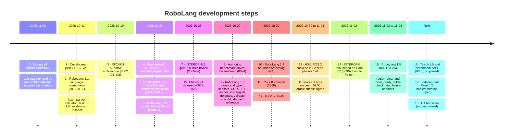

# RoboLang development steps

A one-page history of RoboLang, from the legacy v1 code to RoboLang 1.5 and the ROS 2 physics
simulation backend. Sources: [development plan](DEVELOPMENT_PLAN.md), [strategy](STRATEGY.md),
[decision records](../spec/decisions/) 0001–0035 and git history up to 2026-11-04.

> ⚠️ Everything below is simulation only. Physical execution is not authorized.

The Mermaid diagram below is the editable source. Update it when a step lands.
[`development-steps.png`](development-steps.png) is a static snapshot as of 2026-11-07.

## Horizons ([strategy](STRATEGY.md) section 3)

| Horizon | Target | State on 2026-11-07 |
|---|---|---|
| H1 Trust the basics | ~Nov 2026 | Likely met: reference shipped, PyPI live (≥97% accuracy target not re-checked) |
| H2 Express real requests | ~Q1 2027 | Work done early: 1.4 branching, `validate --world`, Core 0.2 frozen |
| H3 Leave the symbolic world | ~Q2 2027 | Half met: Gazebo task family passes; independent Core 0.2 implementation still open |
| H4 Earn hardware | ~H2 2027 | Not started; needs owner sign-off on a written safety case |
