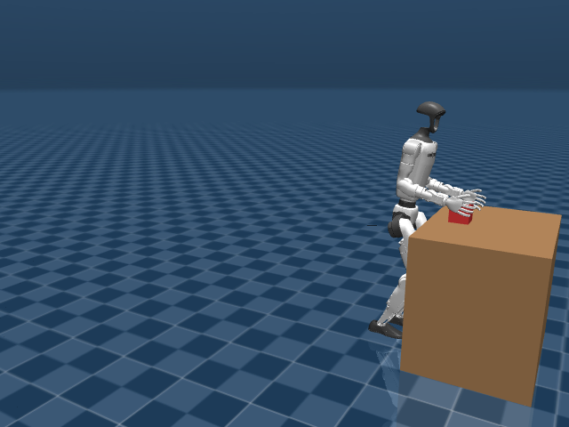

# G1 feasibility spike: MuJoCo, the Unitree SDK and a head camera on CPU

Date: 2026-11-19. For decision [0046](../../spec/decisions/0046-humanoid-backend-unitree-g1.md). Throwaway code, not a
backend: the scripts are in [`g1-spike/`](g1-spike/) so the numbers can be reproduced. They read MuJoCo state, but only
as an oracle to judge the spike itself, never as evidence a backend would use.

**Machine:** the Cloudroom sandbox: x86_64, 4 vCPU, 7 GB RAM, **no GPU**, Debian 12, Python 3.11.2. MuJoCo 4.0.1
rendering offscreen through EGL in software (OSMesa also worked).

**Sources, at these commits (all BSD-3-Clause except `unitree_rl_lab`, Apache-2.0):**
`unitree_mujoco` 1eb6642 (2026-09-07; G1 29-DoF MJCF), `unitree_rl_gym` 276801e (2025-07-25; pretrained G1 walking
policy), `unitree_sdk2_python` 814556d (2026-09-21; installs as `unitree_sdk2py` 1.0.1), `unitree_sdk2` aaf69cb,
`unitree_rl_lab` 4960b84 (2025-11-19; whole-body G1 policy), `mujoco_menagerie` 370c439 (`unitree_g1`, model with hands).

## Results

| Question | Result |
|---|---|
| Does the G1 walk in MuJoCo on this CPU? | **Yes.** `unitree_rl_gym`'s G1 policy on the legs, PD on waist and arms (arms in the trained pose): 2 s standing, 5 s at 0.5 m/s, 2 s at zero. It walked **2.17 m** forward, drifted ≤ 4 cm sideways and stayed upright. 9 s of simulation took 0.43–0.49 s: **18–24× real time**, policy included |
| Does the arm pose matter while walking? | **Yes.** With the forearms raised (shoulder pitch 0.3, elbows 1.0 rad) it stayed upright but drifted about 1 m backwards while "standing" and did not follow the forward command. Arms must stay near the trained pose while walking |
| Can the head camera see and identify an object? | **Yes.** A camera at the G1's D435 mount, pitched down, 640×480: **113–148 ms per frame** in software. After the walk it saw a 9 cm ArUco marker (4×4_50, id 7) on a box on the table, and OpenCV detected it ([frame](g1-spike-head.png)) |
| Does the real SDK interface work against a simulated robot? | **Yes.** Unitree's own, unmodified `LocoClient` called a sim-side `sport` RPC service, built on the SDK's `Server` class, over CycloneDDS on loopback (domain 1). `SetVelocity(0.4, 0, 0, 2.0)` returned code 0 in **0.6–0.9 ms**, and the service received `{"velocity": [0.4, 0, 0], "duration": 2.0}`; `GetFsmId` answered too |
| Can it stand still for arm work? | **Not yet: the main open risk.** The walking policy has no standing mode: at zero command it keeps stepping, with **33–49 cm** of torso sway over 4 s. Holding the leg joints with PD (twice the policy's gains) **fell**, both from rest and after settling. My port of `unitree_rl_lab`'s whole-body velocity policy (ONNX, 480 inputs, 29 outputs) **fell within about 1.5 s**, even at zero command. That is most likely a mismatch in my port (observation layout or model revision); the repo's own C++ sim2sim deploy was not tried |
| Does the backend need PyTorch? | **No.** The `rl_gym` policy is an LSTM (47→64) plus an MLP (64→32→12), 145 KB, small enough for numpy. The `rl_lab` policy needs `onnxruntime` or a numpy port |



## Setup friction

- `cyclonedds==0.10.2` has no wheel for this Python: the CycloneDDS C library (`releases/0.10.x`, 0.10.5) was built
  from source (about 2 minutes on 4 cores) and needed `python3.11-dev`. `unitree_sdk2py` then installed from its
  repository. Phase 1 should cache this build in CI.
- `unitree_mujoco` simulates only the low-level messages (`LowCmd`, `LowState`, `SportModeState`, IMU); the real G1's
  built-in walking service (`sport`) and the `rt/arm_sdk` blending are **not simulated**. A backend has to provide
  stand-ins for both, which is what the RPC test above shows is possible.
- `SportModeState` carries the robot's position in simulation, but the real robot does not publish it once its
  built-in motion service is off (`unitree_mujoco` README). It must never count as evidence.

## Reproduce

```sh
python3 -m venv venv && venv/bin/pip install mujoco numpy pyyaml opencv-python-headless onnxruntime
venv/bin/pip install torch --index-url https://download.pytorch.org/whl/cpu   # only to load the .pt policy
# CycloneDDS: build releases/0.10.x into $CYCLONEDDS_HOME, then: pip install cyclonedds==0.10.2 ./unitree_sdk2_python
M=unitree_mujoco/unitree_robots/g1/scene_29dof.xml; P=unitree_rl_gym/deploy/pre_train/g1/motion.pt
ARMS=zero MUJOCO_GL=egl venv/bin/python -I g1-spike/walk_and_look.py $M $P out/
MUJOCO_GL=egl venv/bin/python -I g1-spike/stand_still.py $M $P
venv/bin/python -I g1-spike/loco_rpc.py
D=unitree_rl_lab/deploy/robots/g1_29dof/config/policy/velocity/v0
MUJOCO_GL=egl venv/bin/python -I g1-spike/whole_body_policy.py $M $D/exported/policy.onnx $D/params/deploy.yaml
```
