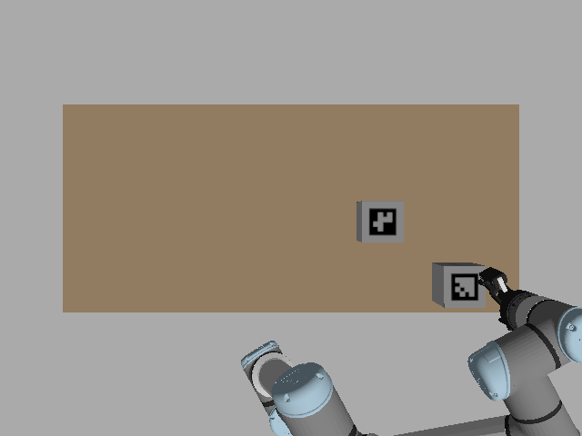
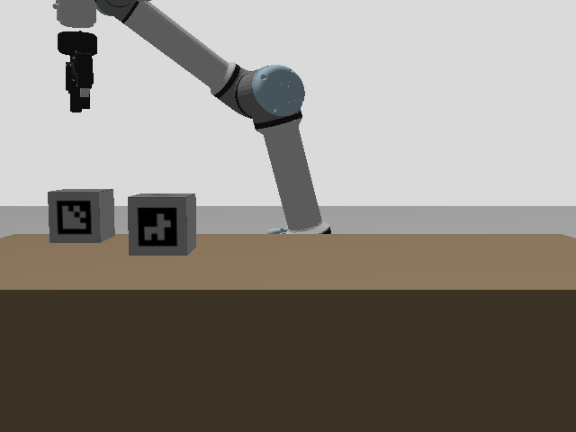

# H3 phase 4: acceptance run findings

Date: 2026-10-31. Decision: [0029](../../spec/decisions/0029-physics-simulation-backend.md), sections 3 and 7 (family chosen by the owner). Contract: [`ros2-backend-v0.1.md`](../../spec/ros2-backend-v0.1.md). [Passing acceptance run](https://github.com/rokorobot/RoboLang/actions/runs/41231728670) (15 parallel scene jobs, 15 minutes end to end); each scene's records, logs and camera frames are in its `ros2-acceptance-<scene>` artifact and the verdict in `ros2-acceptance`.

## Result: passed

| Measure | Result | Bar |
|---|---:|---:|
| Family runs `SUCCEEDED`, verified from observations | 33/33 (11 tasks × 3) | ≥ 90% |
| Observed goal verdicts agreeing with the ground-truth oracle | 51/51 | ≥ 98% |
| False successes | 0 | 0 |
| Scripted failure cases ending `FAILED` with their expected code | 4/4 | 4/4 |

Each run used the unchanged reference `.rob` from `bench/reference/`, in a fresh container with a generated Gazebo world and site file carrying the task's entity IDs. The family: `a_scrap_part`, `a_sort_three`, `e_box_then_dock`, `e_hold_box`, `e_pause_home`, `e_pick_place`, `l_vial_hold`, `l_vial_to_fridge`, `w_part_precheck`, `w_pick_from_table`, `w_split_boxes`. Their goals cover `object_at` (up to three objects), `robot_at` and `holding`; `w_part_precheck` also checks its precondition from observations.

| Failure case (on `e_pick_place`) | Ended |
|---|---|
| Box outside the workcell | S506 at the grasp: marker not seen under the gripper (`unknown`) |
| Box in slot E, not at the declared source | S506 at the grasp: marker seen elsewhere (`false`) |
| Destination 1.3 m from the base | S502: no motion plan |
| A plate in front of each camera | S506 at the grasp: no camera sees the marker |

## Measurements

Final marker readings against the oracle's box face centres, 42 readings: x error mean +0.3 cm (largest 2.2 cm), y mean −1.7 cm (largest 2.9 cm), z mean −1.6 cm (largest 5.8 cm). 30 of the 42 came from the side camera: at the end of a task the gripper often covers the box it just placed from the overhead view. Regions are ±8 cm horizontally and 20–40 cm high, so these errors stay inside them; a box still held over a location reads above 40 cm. Executor wall time per run: 14 to 109 s, median 44 s.

## What changed to get here

- **Two runs before this one did not pass.** In the [first](https://github.com/rokorobot/RoboLang/actions/runs/41229529868), every run failed at its first motion: the new table touched the arm's spawn pose in MoveIt's scene. In the [second](https://github.com/rokorobot/RoboLang/actions/runs/41230603906), 13/33 succeeded and all 19 goal checks agreed; most failures were OMPL paths that MoveIt's own validation then rejected (a finger touching the forearm partway), plus one execution aborted because the arm had not settled at its start.
- **Fixes:** path segments are checked at 0.5% of the state space; a failed plan or a start-state abort is retried from the current state, at most three times per motion; the harness raises the arm to a ready pose before each run (phases 1–3 did this through the smoke test). In the passing run, two motions needed a retry (`a_scrap_part` run 2, `l_vial_to_fridge` run 3). Without retries those two runs would have failed: 31/33, still above the bar.
- **Grasp check from observation:** the detachable joint would attach a box wherever it is, so `grasp` now requires the object's marker seen under the gripper before closing. This is what makes the absent, moved and covered cases fail instead of carrying an unseen box.

## After merge

The [first run on `main`](https://github.com/rokorobot/RoboLang/actions/runs/41242633592) did not pass: 32/33 succeeded and all 44 checked goals agreed, but two `l_vial_hold` runs had no oracle result and were counted as false successes. Their observed verdicts were all `true`; the oracle had crashed parsing `ros2 topic echo` output that contained a dropped-message notice. The oracle now reads the gripper joint by subscription, and the verdict reports runs the oracle could not check as their own blocking count. With that fix the [next run](https://github.com/rokorobot/RoboLang/actions/runs/41243986636) passed again: 33/33, 51/51, no false success, no oracle error, 4/4 failure cases.

The one failed run on `main`, `w_pick_from_table` run 3, ended S501 safely: during the guard, Gazebo did not confirm a detachable-joint attach after five requests. Follow-up: make that startup handshake more robust.

## Limits

- **Grasping is not physical.** The 0.1 m boxes are wider than the Robotiq's 85 mm opening; the grasp pose keeps the fingertips above the box and Gazebo's detachable joint carries it. This run validates planning, execution, observation and verdicts, not contact grasping.
- One acceptance run of 37 runs, not a long-run reliability rate; the nightly workflow repeats it.
- The family excludes tasks with `region_clear` and `robot_ready` (deferred, 0029 section 7), mobile bases, two robots, `inspect`, `wait until`, `communicate`, `@safety`, and `w_two_boxes`.
- Regions and slots were set by hand for this table; the region test catches overlapping regions, not a badly placed one.
