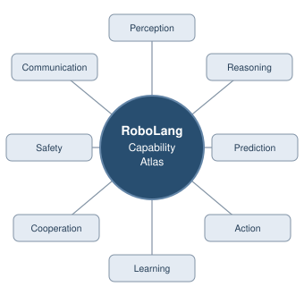

# Humanoid activities and the direction of RoboLang

**Generated** from [`bench/atlas.json`](../../bench/atlas.json) by `python bench/atlas_report.py`; do not edit by
hand. Plan: [RSI-01](rsi-01.md). Sub-activities are added to the atlas as the foresight loop finds them; the
priorities below follow from them.

**Priorities.** A sub-activity's priority is `p × nearness` (`p`: its forecast's probability; nearness: now 1,
1–3y 0.7, 3–7y 0.4, 7y+ 0.1). A direction's priority is the sum of its sub-activities' priorities, each split
evenly over the directions it names. A language gap's priority is the sum over the sub-activities that need it;
it is **near** when one of them is a pilot or deployment within three years, and only near gaps are eligible for
new syntax (strategy rule 1, D5). Out-of-scope gaps are listed but never proposed without a decision record.

## Directions by priority

*Priority* comes from the sub-activities (what robots will do). *Language need* is the sum of the priorities of
the direction's open gaps (what RoboLang lacks there); the two differ when sub-activities of one direction need
gaps of another, e.g. tote handling (action) needs clock readings (reasoning). *Future need* is the sum of `p`
over the direction's far sub-activities (concept or research, or 3+ years away): where the language is headed,
and what a near design must not rule out. It never gives syntax by itself.

| # | Direction | Priority | Language need | Future need | Sub-activities | Near gaps |
|---|---|---|---|---|---|---|
| 1 | action | 3.43 | 3.96 | 0.65 | 14 | G-ACT |
| 2 | perception | 2.33 | 9.06 | 0.45 | 9 | G-CHOOSE, G-PERCEIVE |
| 3 | communication | 0.87 | 2.76 | 0.32 | 5 | G-MSG |
| 4 | cooperation | 0.86 | 1.00 | 1.20 | 8 | G-CONC |
| 5 | learning | 0.62 | 0.39 | 0.38 | 4 | — |
| 6 | autonomy | 0.61 | 1.22 | 0.23 | 3 | G-SELF |
| 7 | reasoning | 0.45 | 5.96 | 0.70 | 5 | G-LOOP, G-CLOCK, G-CALC |
| 8 | safety | 0.43 | 3.18 | 0.55 | 3 | G-PATH |
| 9 | prediction | 0.17 | 0.34 | 0.43 | 2 | — |

## Future direction

Far sub-activities by `p`: what is coming, and the signals that point to it. Leading signals: research,
roadmap, funding, standard, demand, forecast.

| Sub-activity | Directions | Maturity | Horizon | p | Needs | Leading signals |
|---|---|---|---|---|---|---|
| `ACT-SAFE-001` Fence-free humanoid work beside people | safety, cooperation | demo | 3-7y | 0.65 | G-PROX, G-PATH, G-FORCE | — |
| `ACT-AGR-001` Greenhouse fruit harvesting | perception, action | pilot | 3-7y | 0.60 | G-CHOOSE, G-PERCEIVE, G-LOOP, G-CLOCK, G-FORCE | — |
| `ACT-AUTO-003` Self-diagnosis, safe degradation and service requests | autonomy, safety | research | 3-7y | 0.45 | G-SELF | [research](https://arxiv.org/abs/2602.01515) [roadmap](https://en.edaily.co.kr/news/eda202606185436/) |
| `ACT-PRED-002` Checking a plan with a world model before acting | prediction, learning | research | 3-7y | 0.45 | G-PREDICT, G-CHOOSE | — |
| `ACT-HOME-002` General household chores by a home humanoid | action, reasoning | demo | 3-7y | 0.40 | G-CLOCK, G-ACT, G-LOOP, G-CHOOSE, G-PATH, G-PERCEIVE | — |
| `ACT-HRC-002` Following ambiguous and corrective instructions during shared work | reasoning, cooperation | research | 3-7y | 0.40 | G-MSG, G-CHOOSE, G-PERCEIVE | — |
| `ACT-PRED-001` Anticipating a coworker's next movement | prediction, cooperation | research | 3-7y | 0.40 | G-PREDICT, G-PROX | — |
| `ACT-HRC-001` Task-oriented object handover to a person | cooperation, communication | research | 3-7y | 0.35 | G-ACT, G-PERCEIVE, G-MSG, G-CHOOSE | — |
| `ACT-MRC-001` Mixed robot teams on one workflow | cooperation, reasoning | demo | 3-7y | 0.35 | G-CONC, G-CHOOSE, G-MSG | — |
| `ACT-ELD-001` Companion robot in dementia and memory care | communication, perception | pilot | 3-7y | 0.30 | G-CLOCK, G-ACT, G-LOOP, G-PERCEIVE, G-MSG | — |
| `ACT-HOME-001` Laundry folding in the home | learning, action | research | 3-7y | 0.30 | G-ACT, G-LOOP, G-CHOOSE, G-PERCEIVE, G-CALC | — |
| `ACT-ASM-001` Robot-team structural assembly with symbolic replanning | reasoning, cooperation | research | 7y+ | 0.25 | G-LOOP, G-PERCEIVE, G-CONC | — |

## Development log

Newest first. Ranking: the directions in order of priority, with the change of rank since the entry before.

| Date | Note | Added | Removed | Changed | Ranking |
|---|---|---|---|---|---|
| 2026-11-17 | Ninth direction autonomy (owner): 3 sub-activities, new gap G-SELF | ACT-AUTO-001, ACT-AUTO-002, ACT-AUTO-003 | — | — | 1. action 3.43 · 2. perception 2.33 · 3. communication 0.87 · 4. cooperation 0.86 · 5. learning 0.62 · 6. autonomy 0.61 (+3) · 7. reasoning 0.45 (-1) · 8. safety 0.43 (-1) · 9. prediction 0.17 (-1) |
| 2026-11-17 | Foresight pass 1 (R2): 25 sub-activities, 3 new gaps (G-PROX, G-PREDICT, G-TEACH) | ACT-AGR-001, ACT-ASM-001, ACT-CLN-001, ACT-CON-001, ACT-ELD-001, ACT-EV-001, ACT-HLTH-001, ACT-HOME-001, ACT-HOME-002, ACT-HOS-001, ACT-HRC-001, ACT-HRC-002, ACT-INSP-001, ACT-INSP-002, ACT-LOG-001, ACT-LOG-002, ACT-MFG-001, ACT-MFG-002, ACT-MRC-001, ACT-MRC-002, ACT-PRED-001, ACT-PRED-002, ACT-RET-001, ACT-SAFE-001, ACT-SEC-001 | — | — | 1. action 2.91 · 2. perception 2.33 · 3. communication 0.87 · 4. cooperation 0.86 · 5. learning 0.62 · 6. reasoning 0.45 · 7. safety 0.34 · 8. prediction 0.17 · others 0 |

## Action

| Sub-activity | Maturity | Horizon | p | Priority | Needs | Sources |
|---|---|---|---|---|---|---|
| `ACT-AUTO-001` Self-charging on long inspection missions | deployment | now | 0.65 | 0.65 | G-SELF, G-LOOP, G-CHOOSE, G-ACT | [1](https://bostondynamics.com/blog/making-every-step-count-with-spot/) |
| `ACT-LOG-001` Humanoid tote handling in fulfilment centres | deployment | now | 0.60 | 0.60 | G-LOOP, G-CLOCK, G-CALC, G-CHOOSE | [1](https://www.dcvelocity.com/material-handling/robotics/gxo-to-expand-use-of-humanoid-robots-from-agility) |
| `ACT-CLN-001` Scheduled autonomous floor cleaning | deployment | now | 0.55 | 0.55 | G-CLOCK, G-LOOP, G-ACT, G-PATH | [1](https://www.roboticstomorrow.com/news/2026/04/07/brain-corp-launches-brainos-clean-20-with-selfpath-ai-advancing-adaptive-autonomy-for-tennant-company-floor-cleaning-robots/26371/) |
| `ACT-HLTH-001` Hospital delivery and supply runs for nurses and pharmacy | deployment | now | 0.55 | 0.55 | G-ACT, G-MSG, G-LOOP, G-CLOCK | [1](https://www.therobotreport.com/five-years-operation-shape-diligent-robotics-rollout-moxi-2-0/) |
| `ACT-MFG-002` Humanoid-to-tugger handoff of totes in a car plant | pilot | 1-3y | 0.65 | 0.45 | G-MSG, G-CONC, G-CHOOSE | [1](https://agilityrobotics.com/content/agility-robotics-announces-commercial-agreement-with-toyota-motor-manufacturing-canada) [2](https://www.therobotreport.com/bmw-group-deploys-figure-03-humanoid-after-tests-previous-version/) |
| `ACT-CON-001` Construction-site layout printing | deployment | now | 0.45 | 0.45 | G-PATH, G-LOOP, G-PERCEIVE, G-ACT | [1](https://www.dustyrobotics.com/discover/construction-robot) |
| `ACT-HOS-001` Fry-station cooking in restaurant kitchens | deployment | now | 0.45 | 0.45 | G-ACT, G-PERCEIVE | [1](https://www.fastcasual.com/news/miso-robotics-flippy-fry-station-robot-surpasses-5m-baskets) |
| `ACT-LOG-002` Autonomous trailer and container unloading | deployment | now | 0.45 | 0.45 | G-LOOP, G-PERCEIVE, G-CALC | [1](https://www.therobotreport.com/boston-dynamics-built-stretch-gen-2-for-reliable-consistent-performance/) |
| `ACT-MFG-001` Parts sequencing for the assembly line | pilot | 1-3y | 0.60 | 0.42 | G-LOOP, G-CHOOSE, G-MSG, G-CLOCK | [1](https://www.therobotreport.com/bmw-group-deploys-figure-03-humanoid-after-tests-previous-version/) |
| `ACT-AUTO-002` Battery swapping for whole-shift humanoid work | demo | 1-3y | 0.55 | 0.39 | G-SELF, G-LOOP, G-ACT | [1](https://newatlas.com/ai-humanoids/walker-s2-humanoid-robot-swaps-batteries) |
| `ACT-EV-001` Robotic EV charging in garages and depots | pilot | 1-3y | 0.55 | 0.39 | G-ACT, G-MSG, G-CHOOSE, G-LOOP | [1](https://electrek.co/2026/02/23/china-overhead-rail-ev-charging-robots-parking-garages/) |
| `ACT-AGR-001` Greenhouse fruit harvesting | pilot | 3-7y | 0.60 | 0.24 | G-CHOOSE, G-PERCEIVE, G-LOOP, G-CLOCK, G-FORCE | [1](https://www.freshplaza.com/europe/article/9842754/japanese-agri-tech-startup-puts-cherry-tomato-harvesting-robot-into-routine-production-use/) |
| `ACT-HOME-002` General household chores by a home humanoid | demo | 3-7y | 0.40 | 0.16 | G-CLOCK, G-ACT, G-LOOP, G-CHOOSE, G-PATH, G-PERCEIVE | [1](https://heise.de/-11287205) |
| `ACT-HOME-001` Laundry folding in the home | research | 3-7y | 0.30 | 0.12 | G-ACT, G-LOOP, G-CHOOSE, G-PERCEIVE, G-CALC | [1](https://arxiv.org/abs/2511.14759) |

| Language gap | Scope | Priority | Near | Benchmark tasks |
|---|---|---|---|---|
| `G-ACT` Actions beyond move, grasp, place, inspect, wait, communicate, measure: open, charge, set a device | open | 3.96 | yes | 3 |

## Perception

| Sub-activity | Maturity | Horizon | p | Priority | Needs | Sources |
|---|---|---|---|---|---|---|
| `ACT-INSP-001` Autonomous gauge and thermal inspection rounds | demo | now | 0.80 | 0.80 | G-PERCEIVE, G-LOOP, G-CLOCK | [1](https://www.therobotreport.com/boston-dynamics-releases-spot-and-orbit-5-1-with-new-spot-cam/) |
| `ACT-RET-001` Store shelf scanning and out-of-stock reporting | deployment | now | 0.55 | 0.55 | G-CLOCK, G-LOOP, G-PERCEIVE, G-CHOOSE | [1](https://theshelbyreport.com/2026/09/21/simbe-surpasses-3000-units-in-shelf-intelligence-fleet/) |
| `ACT-CON-001` Construction-site layout printing | deployment | now | 0.45 | 0.45 | G-PATH, G-LOOP, G-PERCEIVE, G-ACT | [1](https://www.dustyrobotics.com/discover/construction-robot) |
| `ACT-HOS-001` Fry-station cooking in restaurant kitchens | deployment | now | 0.45 | 0.45 | G-ACT, G-PERCEIVE | [1](https://www.fastcasual.com/news/miso-robotics-flippy-fry-station-robot-surpasses-5m-baskets) |
| `ACT-LOG-002` Autonomous trailer and container unloading | deployment | now | 0.45 | 0.45 | G-LOOP, G-PERCEIVE, G-CALC | [1](https://www.therobotreport.com/boston-dynamics-built-stretch-gen-2-for-reliable-consistent-performance/) |
| `ACT-SEC-001` Security patrol that reacts to people | demo | 1-3y | 0.60 | 0.42 | G-LOOP, G-CLOCK, G-PERCEIVE, G-PROX, G-PATH | [1](https://www.therobotreport.com/boston-dynamics-releases-spot-and-orbit-5-1-with-new-spot-cam/) |
| `ACT-INSP-002` Inspection that learns the facility | demo | 1-3y | 0.55 | 0.39 | G-TEACH, G-PERCEIVE, G-CALC | [1](https://bostondynamics.com/blog/aivi-learning-now-powered-google-gemini-robotics/) |
| `ACT-AGR-001` Greenhouse fruit harvesting | pilot | 3-7y | 0.60 | 0.24 | G-CHOOSE, G-PERCEIVE, G-LOOP, G-CLOCK, G-FORCE | [1](https://www.freshplaza.com/europe/article/9842754/japanese-agri-tech-startup-puts-cherry-tomato-harvesting-robot-into-routine-production-use/) |
| `ACT-ELD-001` Companion robot in dementia and memory care | pilot | 3-7y | 0.30 | 0.12 | G-CLOCK, G-ACT, G-LOOP, G-PERCEIVE, G-MSG | [1](https://health.ucdavis.edu/medical-center/news/headlines/uc-davis-launches-first-long-term-us-study-led-by-nurses-on-humanoid-robots-in-dementia-care/2026/05) |

| Language gap | Scope | Priority | Near | Benchmark tasks |
|---|---|---|---|---|
| `G-CHOOSE` Choosing objects or robots at run time | open | 4.59 | yes | 2 |
| `G-PERCEIVE` Conditions on perceived properties (dirty, damaged) | open | 4.47 | yes | 2 |

## Communication

| Sub-activity | Maturity | Horizon | p | Priority | Needs | Sources |
|---|---|---|---|---|---|---|
| `ACT-HLTH-001` Hospital delivery and supply runs for nurses and pharmacy | deployment | now | 0.55 | 0.55 | G-ACT, G-MSG, G-LOOP, G-CLOCK | [1](https://www.therobotreport.com/five-years-operation-shape-diligent-robotics-rollout-moxi-2-0/) |
| `ACT-RET-001` Store shelf scanning and out-of-stock reporting | deployment | now | 0.55 | 0.55 | G-CLOCK, G-LOOP, G-PERCEIVE, G-CHOOSE | [1](https://theshelbyreport.com/2026/09/21/simbe-surpasses-3000-units-in-shelf-intelligence-fleet/) |
| `ACT-MRC-002` Multi-vendor fleet interoperability | demo | 1-3y | 0.55 | 0.39 | G-MSG, G-CHOOSE, G-CONC | [1](https://www.therobotreport.com/new-iso-interoperability-standard-covers-collaboration-among-mobile-robots-from-multiple-vendors/) |
| `ACT-HRC-001` Task-oriented object handover to a person | research | 3-7y | 0.35 | 0.14 | G-ACT, G-PERCEIVE, G-MSG, G-CHOOSE | [1](https://arxiv.org/abs/2602.05760v1) |
| `ACT-ELD-001` Companion robot in dementia and memory care | pilot | 3-7y | 0.30 | 0.12 | G-CLOCK, G-ACT, G-LOOP, G-PERCEIVE, G-MSG | [1](https://health.ucdavis.edu/medical-center/news/headlines/uc-davis-launches-first-long-term-us-study-led-by-nurses-on-humanoid-robots-in-dementia-care/2026/05) |

| Language gap | Scope | Priority | Near | Benchmark tasks |
|---|---|---|---|---|
| `G-MSG` Waiting for an incoming message, or confirming delivery | open | 2.76 | yes | 5 |

## Cooperation

| Sub-activity | Maturity | Horizon | p | Priority | Needs | Sources |
|---|---|---|---|---|---|---|
| `ACT-MFG-002` Humanoid-to-tugger handoff of totes in a car plant | pilot | 1-3y | 0.65 | 0.45 | G-MSG, G-CONC, G-CHOOSE | [1](https://agilityrobotics.com/content/agility-robotics-announces-commercial-agreement-with-toyota-motor-manufacturing-canada) [2](https://www.therobotreport.com/bmw-group-deploys-figure-03-humanoid-after-tests-previous-version/) |
| `ACT-MRC-002` Multi-vendor fleet interoperability | demo | 1-3y | 0.55 | 0.39 | G-MSG, G-CHOOSE, G-CONC | [1](https://www.therobotreport.com/new-iso-interoperability-standard-covers-collaboration-among-mobile-robots-from-multiple-vendors/) |
| `ACT-SAFE-001` Fence-free humanoid work beside people | demo | 3-7y | 0.65 | 0.26 | G-PROX, G-PATH, G-FORCE | [1](https://letsdatascience.com/news/agility-robotics-previews-cage-free-digit-v5-847ce6a1) [2](https://www.i-scoop.eu/iso-25785-1-explained-and-what-it-means-for-humanoid-robot-safety/) |
| `ACT-HRC-002` Following ambiguous and corrective instructions during shared work | research | 3-7y | 0.40 | 0.16 | G-MSG, G-CHOOSE, G-PERCEIVE | [1](https://arxiv.org/abs/2602.14551) |
| `ACT-PRED-001` Anticipating a coworker's next movement | research | 3-7y | 0.40 | 0.16 | G-PREDICT, G-PROX | [1](https://arxiv.org/abs/2604.03065) |
| `ACT-HRC-001` Task-oriented object handover to a person | research | 3-7y | 0.35 | 0.14 | G-ACT, G-PERCEIVE, G-MSG, G-CHOOSE | [1](https://arxiv.org/abs/2602.05760v1) |
| `ACT-MRC-001` Mixed robot teams on one workflow | demo | 3-7y | 0.35 | 0.14 | G-CONC, G-CHOOSE, G-MSG | [1](https://deepmind.google/blog/gemini-robotics-2-brings-whole-body-intelligence-to-robots/) |
| `ACT-ASM-001` Robot-team structural assembly with symbolic replanning | research | 7y+ | 0.25 | 0.03 | G-LOOP, G-PERCEIVE, G-CONC | [1](https://arxiv.org/abs/2601.00978v1) |

| Language gap | Scope | Priority | Near | Benchmark tasks |
|---|---|---|---|---|
| `G-CONC` Several robots acting at the same time | open | 1.00 | yes | 2 |

## Learning

| Sub-activity | Maturity | Horizon | p | Priority | Needs | Sources |
|---|---|---|---|---|---|---|
| `ACT-CLN-001` Scheduled autonomous floor cleaning | deployment | now | 0.55 | 0.55 | G-CLOCK, G-LOOP, G-ACT, G-PATH | [1](https://www.roboticstomorrow.com/news/2026/04/07/brain-corp-launches-brainos-clean-20-with-selfpath-ai-advancing-adaptive-autonomy-for-tennant-company-floor-cleaning-robots/26371/) |
| `ACT-INSP-002` Inspection that learns the facility | demo | 1-3y | 0.55 | 0.39 | G-TEACH, G-PERCEIVE, G-CALC | [1](https://bostondynamics.com/blog/aivi-learning-now-powered-google-gemini-robotics/) |
| `ACT-PRED-002` Checking a plan with a world model before acting | research | 3-7y | 0.45 | 0.18 | G-PREDICT, G-CHOOSE | [1](https://arxiv.org/abs/2606.13672) |
| `ACT-HOME-001` Laundry folding in the home | research | 3-7y | 0.30 | 0.12 | G-ACT, G-LOOP, G-CHOOSE, G-PERCEIVE, G-CALC | [1](https://arxiv.org/abs/2511.14759) |

| Language gap | Scope | Priority | Near | Benchmark tasks |
|---|---|---|---|---|
| `G-TEACH` Teaching the robot a new skill, object or route by demonstration or correction, then using it by name | open | 0.39 | — | 0 |

## Autonomy

| Sub-activity | Maturity | Horizon | p | Priority | Needs | Sources |
|---|---|---|---|---|---|---|
| `ACT-AUTO-001` Self-charging on long inspection missions | deployment | now | 0.65 | 0.65 | G-SELF, G-LOOP, G-CHOOSE, G-ACT | [1](https://bostondynamics.com/blog/making-every-step-count-with-spot/) |
| `ACT-AUTO-002` Battery swapping for whole-shift humanoid work | demo | 1-3y | 0.55 | 0.39 | G-SELF, G-LOOP, G-ACT | [1](https://newatlas.com/ai-humanoids/walker-s2-humanoid-robot-swaps-batteries) |
| `ACT-AUTO-003` Self-diagnosis, safe degradation and service requests | research | 3-7y | 0.45 | 0.18 | G-SELF | [1](https://en.edaily.co.kr/news/eda202606185436/) [2](https://arxiv.org/abs/2602.01515) |

| Language gap | Scope | Priority | Near | Benchmark tasks |
|---|---|---|---|---|
| `G-SELF` The robot's own state as readings and conditions: battery level, health, faults; acting on them and asking for service | open | 1.22 | yes | 0 |

## Reasoning

| Sub-activity | Maturity | Horizon | p | Priority | Needs | Sources |
|---|---|---|---|---|---|---|
| `ACT-MFG-001` Parts sequencing for the assembly line | pilot | 1-3y | 0.60 | 0.42 | G-LOOP, G-CHOOSE, G-MSG, G-CLOCK | [1](https://www.therobotreport.com/bmw-group-deploys-figure-03-humanoid-after-tests-previous-version/) |
| `ACT-HOME-002` General household chores by a home humanoid | demo | 3-7y | 0.40 | 0.16 | G-CLOCK, G-ACT, G-LOOP, G-CHOOSE, G-PATH, G-PERCEIVE | [1](https://heise.de/-11287205) |
| `ACT-HRC-002` Following ambiguous and corrective instructions during shared work | research | 3-7y | 0.40 | 0.16 | G-MSG, G-CHOOSE, G-PERCEIVE | [1](https://arxiv.org/abs/2602.14551) |
| `ACT-MRC-001` Mixed robot teams on one workflow | demo | 3-7y | 0.35 | 0.14 | G-CONC, G-CHOOSE, G-MSG | [1](https://deepmind.google/blog/gemini-robotics-2-brings-whole-body-intelligence-to-robots/) |
| `ACT-ASM-001` Robot-team structural assembly with symbolic replanning | research | 7y+ | 0.25 | 0.03 | G-LOOP, G-PERCEIVE, G-CONC | [1](https://arxiv.org/abs/2601.00978v1) |

| Language gap | Scope | Priority | Near | Benchmark tasks |
|---|---|---|---|---|
| `G-LOOP` Repetition without a fixed bound: loops, retry until it works, schedules, event streams | out | 6.88 | yes | 12 |
| `G-CLOCK` Clock readings and times of day | open | 4.41 | yes | 5 |
| `G-CALC` Arithmetic, counting and text built from values | open | 1.55 | yes | 4 |
| `G-FALLBACK` A different end state counts as done | out | 0.00 | — | 1 |

## Safety

| Sub-activity | Maturity | Horizon | p | Priority | Needs | Sources |
|---|---|---|---|---|---|---|
| `ACT-SEC-001` Security patrol that reacts to people | demo | 1-3y | 0.60 | 0.42 | G-LOOP, G-CLOCK, G-PERCEIVE, G-PROX, G-PATH | [1](https://www.therobotreport.com/boston-dynamics-releases-spot-and-orbit-5-1-with-new-spot-cam/) |
| `ACT-SAFE-001` Fence-free humanoid work beside people | demo | 3-7y | 0.65 | 0.26 | G-PROX, G-PATH, G-FORCE | [1](https://letsdatascience.com/news/agility-robotics-previews-cage-free-digit-v5-847ce6a1) [2](https://www.i-scoop.eu/iso-25785-1-explained-and-what-it-means-for-humanoid-robot-safety/) |
| `ACT-AUTO-003` Self-diagnosis, safe degradation and service requests | research | 3-7y | 0.45 | 0.18 | G-SELF | [1](https://en.edaily.co.kr/news/eda202606185436/) [2](https://arxiv.org/abs/2602.01515) |

| Language gap | Scope | Priority | Near | Benchmark tasks |
|---|---|---|---|---|
| `G-PATH` Staying inside or outside a region while moving | open | 1.84 | yes | 2 |
| `G-PROX` Limits and reactions that depend on people nearby: slow, stop or yield when a person is within a distance | open | 0.84 | — | 0 |
| `G-FORCE` Force limits and gentle handling | open | 0.50 | — | 1 |

## Prediction

| Sub-activity | Maturity | Horizon | p | Priority | Needs | Sources |
|---|---|---|---|---|---|---|
| `ACT-PRED-002` Checking a plan with a world model before acting | research | 3-7y | 0.45 | 0.18 | G-PREDICT, G-CHOOSE | [1](https://arxiv.org/abs/2606.13672) |
| `ACT-PRED-001` Anticipating a coworker's next movement | research | 3-7y | 0.40 | 0.16 | G-PREDICT, G-PROX | [1](https://arxiv.org/abs/2604.03065) |

| Language gap | Scope | Priority | Near | Benchmark tasks |
|---|---|---|---|---|
| `G-PREDICT` Acting on a predicted future: a person's next move, the outcome of a plan, time to failure | open | 0.34 | — | 0 |
